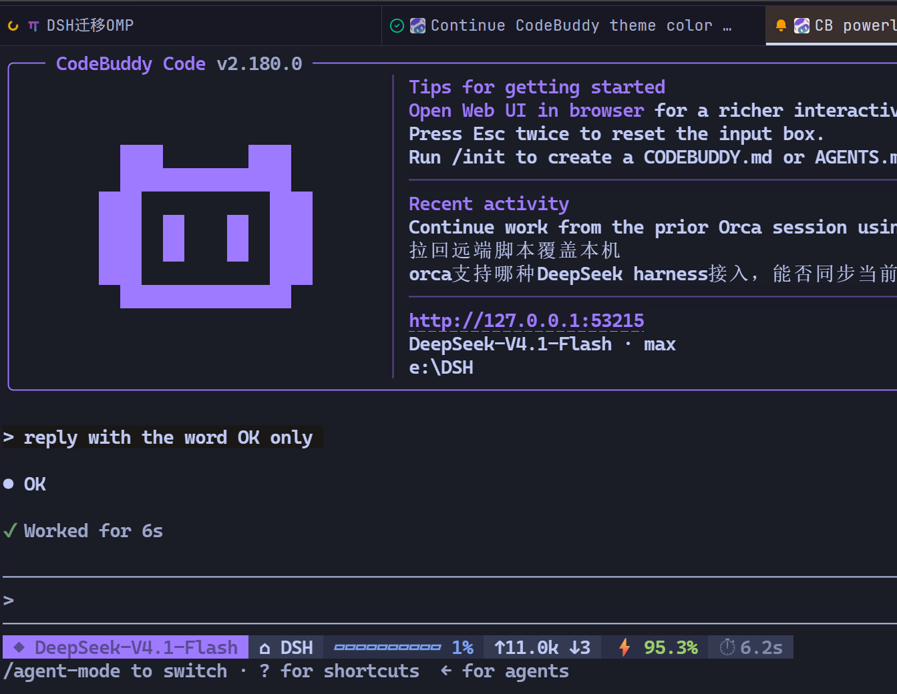

# codebuddy-cli-beautify

给 **CodeBuddy CLI** 换上 omp 的观感：obsidian 紫配色 + 多色 powerline 状态栏。



> Orca 内置终端里的实际效果：紫边欢迎框、紫色 logo、冷白正文，底部是六段式状态栏。

## 特性

- **配色**：改写 bundle 里的 `dark` 主题字面量，把 49 个颜色键对齐 omp 的 obsidian 主题。正文设为空串继承终端前景色，因此能跟随任意终端主题；强调色统一为紫 `#9d7aff`，表格线 `#656b83`，用户消息底 `#1a1816`。
- **状态栏**：单行多段 powerline，每段独立 ANSI 真彩背景 —— 模型 / 目录 / git 分支 / 上下文进度 / 输入输出 token / 缓存命中率 / 本轮工具调用 / 本轮耗时。
- **幂等**：重复运行只重打补丁；`--force` 从备份还原后重打。
- **可逆**：`uninstall.mjs` 还原 bundle 与 settings。

## 安装

### 方式一：作为 CodeBuddy 插件（推荐）

```bash
/plugin marketplace add wahaha1024/codebuddy-cli-beautify
/plugin install codebuddy-cli-beautify@codebuddy-beautify
/reload-plugins
```

插件自带 `SessionStart` 钩子：下一次会话启动时若检测到 bundle 还没打补丁，会自动跑一次安装并提示重启。也可以用 `/codebuddy-cli-beautify:beautify` 显式调用技能。

### 方式二：直接跑安装脚本

需要 Node ≥ 18，且已安装 CodeBuddy CLI。

```bash
git clone https://github.com/wahaha1024/codebuddy-cli-beautify.git
node codebuddy-cli-beautify/plugin/scripts/install.mjs
```

安装脚本会：

1. 定位 codebuddy 包（`npm root -g` → `which codebuddy` → 平台常见路径），把 `dist/codebuddy.js` 备份为 `.orig-beautify`，再把 `{name:"dark",colors:{…}}` 整段替换成 obsidian 调色板；
2. 往 `~/.codebuddy/settings.json` 写入 `theme: "dark"` 和 `statusLine` 命令，首次备份为 `settings.json.bak-beautify`。

**新开一个 codebuddy 会话**生效。

| 参数 | 作用 |
|---|---|
| `--dry-run` | 只报告将要做什么，不写入 |
| `--no-theme` | 只装状态栏 |
| `--no-statusline` | 只装配色 |
| `--style nerd\|unicode\|ascii` | 状态栏符号风格（同时写入提示） |
| `--force` | 已打过补丁也重打（换配色后使用） |

## 状态栏

```
◆ DeepSeek-V4.1-Flash  ⌂ projects  ⎇ main *2  ▰▰▰▱▱▱▱▱▱▱ 32%  ↑85.9k ↓549  ⚡ 99.3%  ⚙ 17 Bash  ⏱ 5m45s
└────── 紫底 ──────┘  └─ 暗底 ─┘  └─ 暗底 ─┘  └─ 暗底 ─┘  └── 暗底 ──┘  └─ 绿 ─┘  └── 灰 ──┘  └── 灰 ──┘
```

| 环境变量 | 默认 | 说明 |
|---|---|---|
| `CODEBUDDY_BEAUTIFY_STYLE` | `unicode` | `nerd` 用 PUA 图标（需 Nerd Font）、`unicode` 用几何符号、`ascii` 纯 ASCII |
| `CODEBUDDY_BEAUTIFY_POWERLINE` | 开 | 每段独立 ANSI 真彩背景色块；设 `0` 退回单色 `·` 分隔 |
| `CODEBUDDY_BEAUTIFY_COLOR` | 开 | powerline 关闭时按 obsidian 调色板上色；设 `0` 关闭全部 ANSI |
| `CODEBUDDY_BEAUTIFY_CTX` | 取 payload | 上下文窗口大小，用于算百分比 |

数据来自 codebuddy 传给 statusLine 的 JSON payload；缺失时回落到 transcript 尾部 96KB 扫描。`git status` 按目录缓存 1.5s，避免高频重绘反复起进程。

## 换配色

调色板在 `plugin/lib/theme.mjs` 的 `OBSIDIAN` 里，改完执行：

```bash
node plugin/scripts/install.mjs --force --no-statusline
```

`--force` 会先用 `.orig-beautify` 备份还原、再按新调色板重打。

## 体检与卸载

```bash
node plugin/scripts/status.mjs      # 版本 / 补丁状态 / settings / 渲染预览
node plugin/scripts/uninstall.mjs   # 还原 bundle 与 settings
```

## 已知限制

- CodeBuddy 的 `theme` 只接受 6 个枚举值，不支持自定义主题对象，所以配色必须改写 bundle。升级 codebuddy 会覆盖 `dist/codebuddy.js`，重跑 `install.mjs` 即可（脚本幂等；锚点缺失时只提示、不写入）。
- 状态栏在 **Windows Terminal** 里不渲染（2.180.0 的 TUI 不挂载 StatusLine 组件），在 **Orca 内置终端 / Linux 终端** 里正常。配色在两种终端都生效。
- 行内代码没有背景色：codebuddy 的 `colors` 里没有行内代码背景键，只有前景色。
- 终端必须支持真彩，且环境里不能有 `NO_COLOR` —— 它会让 codebuddy 走全空主题，看起来像"补丁没生效"。
- 状态栏命令用安装时的 `process.execPath`，换 Node 版本后重跑安装。

## 原理

- **配色**：锚点 `{name:"dark",colors:{` … `}},eh={name:"light-colorblind"`，整段 JSON 被替换成由 `buildDarkTheme(OBSIDIAN)` 生成的对象；`MARK` 指纹用 logo 色 `"logo":{"edge":"#9d7aff"` 判断是否已打补丁。
- **状态栏**：`settings.json` 的 `statusLine.command` 指向 `lib/statusbar.cjs`，codebuddy 每轮把 payload 从 stdin 传入，脚本输出一行文本（含 ANSI 转义）。

## 目录

```
.codebuddy-plugin/marketplace.json   # 本地市场定义
plugin/
  .codebuddy-plugin/plugin.json
  lib/locate.mjs                     # 定位 codebuddy 包与 settings
  lib/theme.mjs                      # obsidian 调色板 + 49 键映射 + 补丁/还原
  lib/statusbar.cjs                  # 状态栏渲染（statusLine 入口）
  scripts/{install,uninstall,status}.mjs
docs/statusline.png
```

## License

MIT
